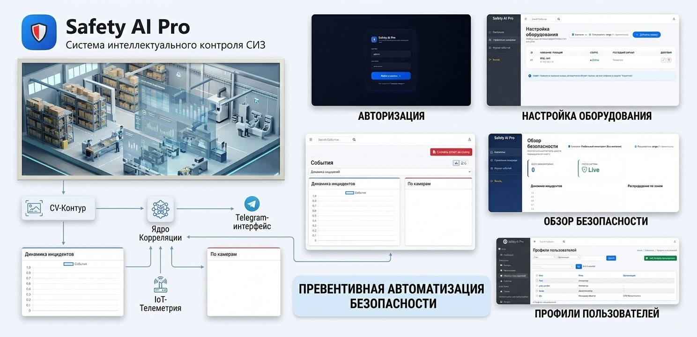
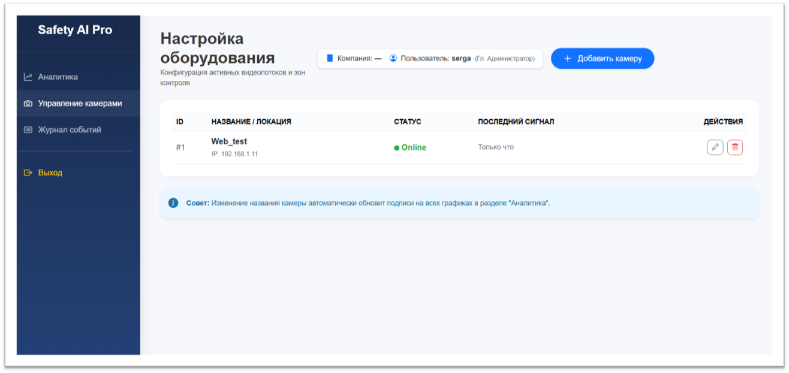
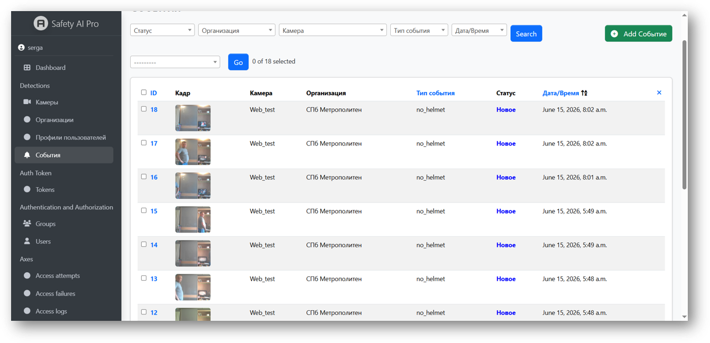
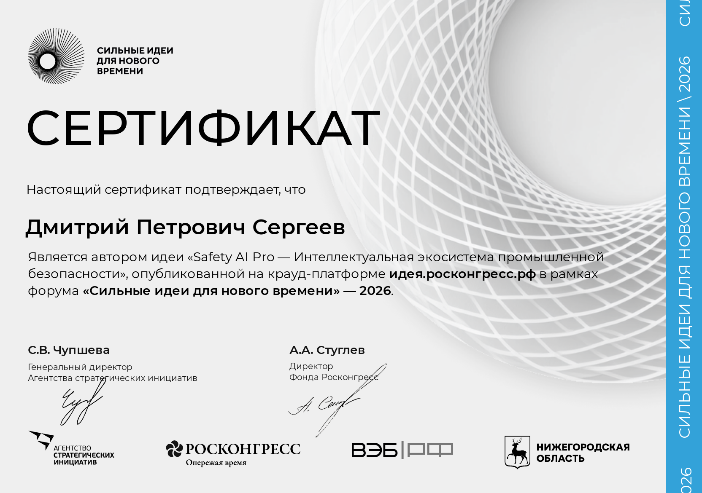
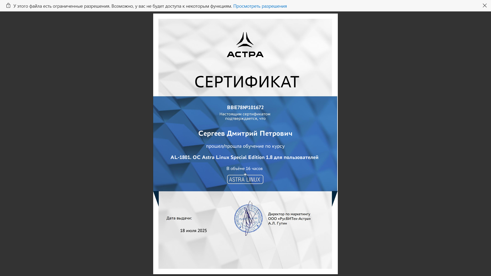
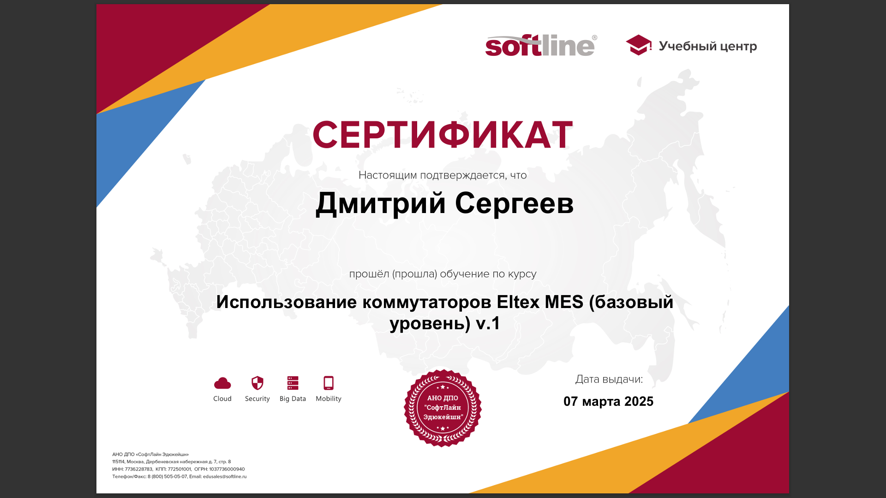

  <h1>🛡️ Safety AI Pro (SteelEye)</h1>
  
<b>Интеллектуальная экосистема промышленной безопасности</b>

  
  

    
    
    
  

---

## 👁️ Безопасность, которая работает на опережение

**Safety AI Pro** — это не просто система видеонаблюдения. Это цифровой двойник вашего производства, который **видит** нарушения, **чувствует** параметры оборудования и **мыслит** как строгий, но справедливый инспектор.

Мы объединили три контура в единую экосистему:
* 🎥 **Компьютерное зрение (AI):** Мгновенное распознавание отсутствия каски, жилета или нахождения в опасной зоне.
* 🌡️ **Интернет вещей (IoT):** Сбор телеметрии с оборудования и датчиков в реальном времени.
* 🏛️ **Государственный комплаенс (GovTech):** Автоматическая подготовка отчетов для Ростехнадзора и интеграция с ЕИСОТ.

  

---

## 💡 Почему заказчики выбирают нас?

Мы создали систему, которая окупается быстрее, чем вы успеваете провести планерку.

| Показатель | Результат | Как это работает |
| :--- | :--- | :--- |
| **💰 ROI (Окупаемость)** | **342% за 12 мес** | Снижение штрафов и страховых премий. |
| **⏱️ Окупаемость внедрения** | **4.2 месяца** | За счет предотвращения простоев и травм. |
| **📉 Снижение нарушений (СИЗ)** | **87%** | Эффект плацебо: камеры «видят» всё, и люди начинают соблюдать правила. |
| **⚡ Скорость реакции** | **< 0.2 сек** | От попадания кадра в объектив до сигнала в Telegram инспектору. |
| **📹 Экономия на «железе»** | **12+ камер на 1 сервер** | Работает на обычном Intel i7 без дорогих GPU-ферм. |

---

## 📸 Как это выглядит в работе

Интерфейс создан для людей, а не для роботов. Интуитивно понятный дашборд, журнал событий с доказательной базой и мгновенные уведомления.

  <table border="0">
    <tr>
      <td width="50%">
         
        <b>Обзор безопасности:</b> Все инциденты на одном экране.
      </td>
      <td width="50%">
         
        <b>Журнал событий:</b> Каждое нарушение зафиксировано с фото и таймстампом.
      </td>
    </tr>
  </table>

---

## 🏆 Экспертиза и Признание

Проект высоко оценен на федеральном уровне. Мы не просто пишем код — мы создаем стандарты безопасности будущего.

  <table border="0">
    <tr>
      <td align="center" width="33%">
         
        <b>Автор идеи</b> 
        <i>Форум «Сильные идеи для нового времени» 2026</i>
      </td>
      <td align="center" width="33%">
        
         
        <b>Аттестованный специалист</b> 
        <i>ОС Astra Linux Special Edition 1.8</i>
      </td>
      <td align="center" width="33%">
        
         
        <b>Сетевые технологии</b> 
        <i>Коммутаторы Eltex MES (базовый уровень)</i>
      </td>
    </tr>
  </table>

---

## 🗺️ Наши планы (Roadmap)

Мы постоянно развиваемся, чтобы закрыть все потребности промышленности.

  <table border="0" style="text-align: left;">
    <tr>
      <td width="33%" valign="top">
        <h4>✅ Уже работает</h4>
        <ul>
          <li>Детекция касок (точность 99.5%)</li>
          <li>Telegram-бот для инспекторов</li>
          <li>Автоматические PDF-отчеты</li>
          <li>Собственное облачное хранилище (MinIO)</li>
          <li>Разграничение прав доступа (RBAC)</li>
        </ul>
      </td>
      <td width="33%" valign="top">
        <h4>🚧 В разработке</h4>
        <ul>
          <li>Детекция жилетов и очков</li>
          <li>Распознавание лиц (FaceID)</li>
          <li>Блокировка турникетов (СКУД)</li>
          <li>Интеграция с Prometheus/Grafana</li>
        </ul>
      </td>
      <td width="33%" valign="top">
        <h4>🌌 В планах</h4>
        <ul>
          <li>Edge-вычисления (Raspberry Pi)</li>
          <li>Мобильное приложение (React Native)</li>
          <li>White-label для партнеров</li>
          <li>Тепловые карты опасных зон</li>
        </ul>
      </td>
    </tr>
  </table>

---

## 🤝 Сотрудничество

Мы открыты к пилотным проектам, интеграциям и государственным контрактам. 

**Автор и идеолог проекта:**
**Сергеев Дмитрий Петрович** — CV Engineer / AI Architect

* 🌐 [Профиль проекта на платформе НТИ / Росконгресс](https://xn--d1ach8g.xn--c1aenmdblfega.xn--p1ai/improject-217115/ideas/286455)
* 🐙 [GitHub автора](https://github.com/Dimsan23)
* 📧 **Email:** serga.cv@example.com *(замените на реальный)*

 

  <i>Safety AI Pro — Цифровой комплаенс, которому доверяет государство.</i>

